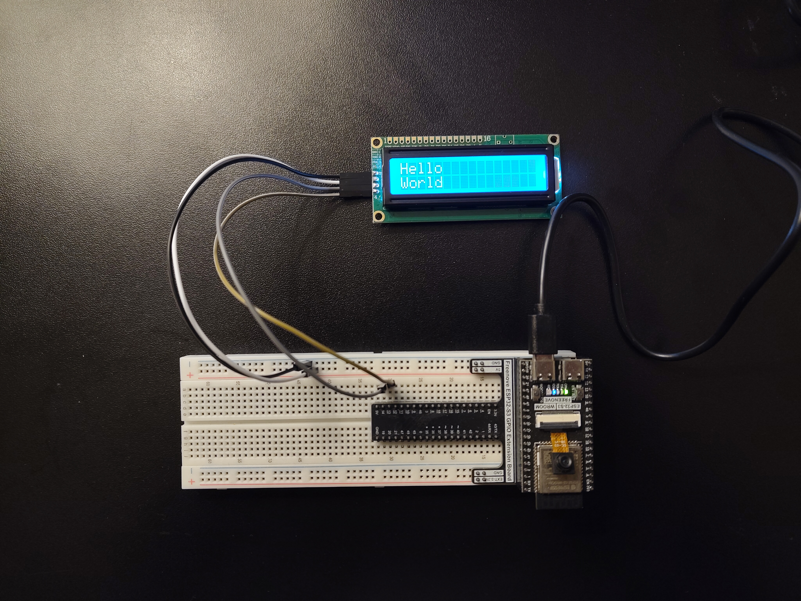

# SPIFFS File Storage and I2C LCD1602 (ESP32-S3)

An ESP-IDF/C project that writes "Hello" and "World" to a SPIFFS file, reads the stored text back, and displays it on a two-line I2C LCD1602.

Developed with ESP-IDF v6.1-beta1 for the ESP32-S3.

## Demonstrated concepts

- SPIFFS flash storage and C file operations (`fopen`, `fprintf`, `fgets`)
- Error checking and string handling
- I2C communication with an LCD1602 display

## Hardware

- ESP32-S3 development board
- LCD1602 with I2C backpack (address `0x27`)
- SDA: GPIO14; SCL: GPIO13; common ground

## Demonstration



The LCD displays **Hello** on the first line and **World** on the second, using text read from the SPIFFS file.

## Build

This project requires the `HD44780` LCD driver and a partition table with a SPIFFS partition labeled `storage`. Include those supporting files in the repository.

```bash
idf.py build
idf.py flash monitor
```

## Provenance

Developed for ECEN 621: Embedded Computing System Design at North Carolina A&T State University.
